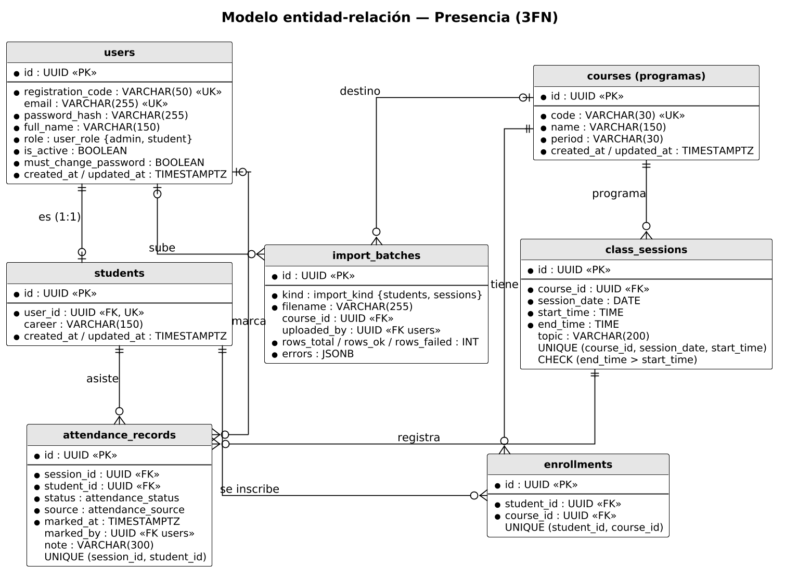
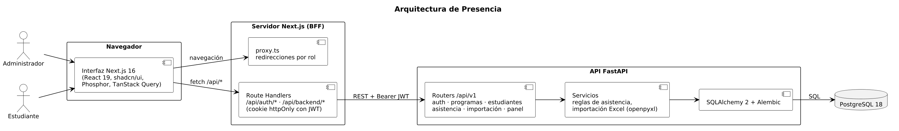
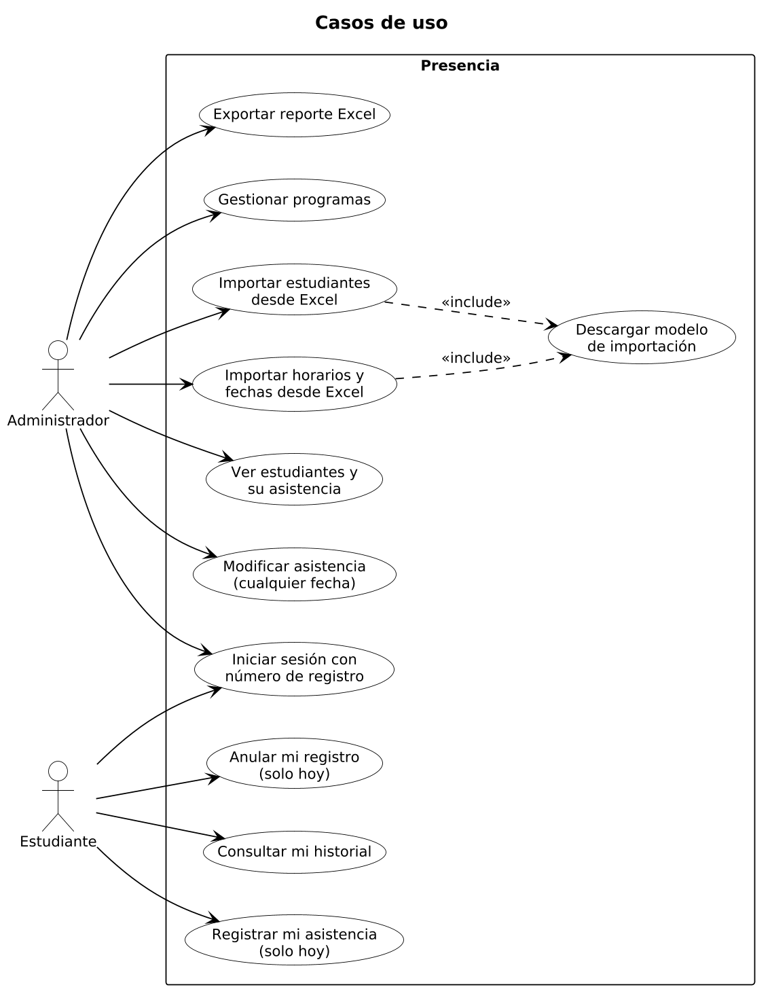
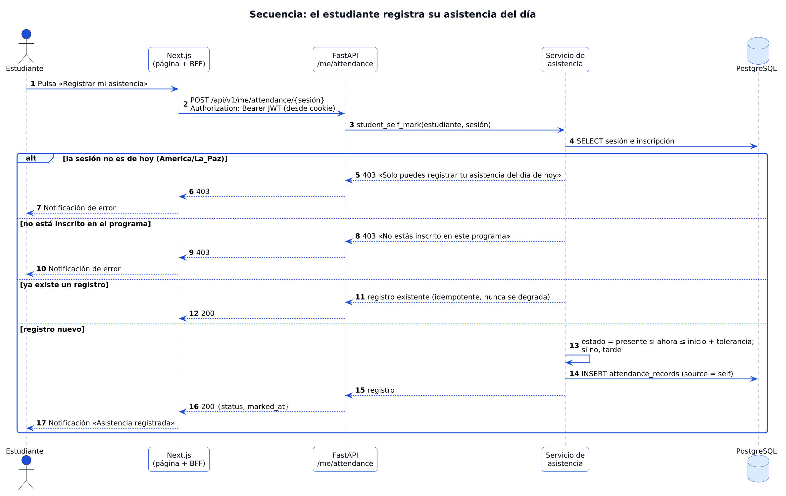
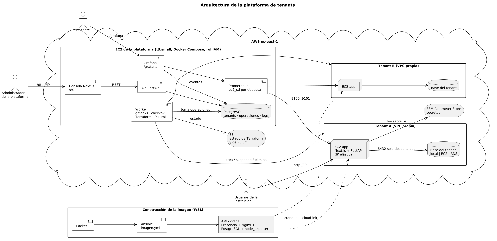
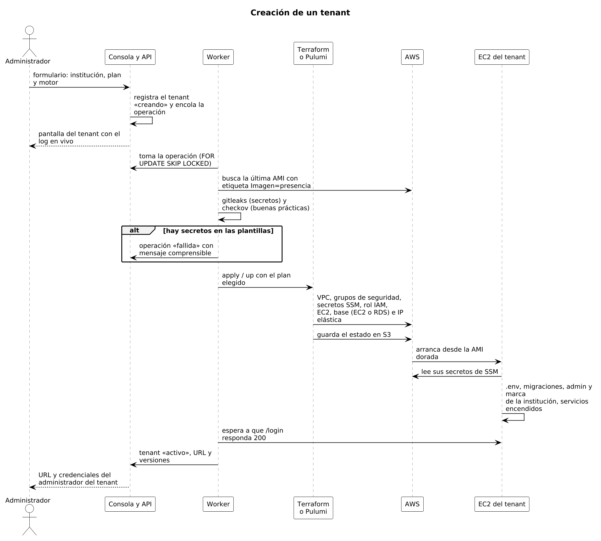

# Presencia · Sistema de registro de asistencia

Aplicación web para registrar y controlar la asistencia de estudiantes en uno o varios
programas académicos. Desarrollada por el **grupo GPT-6 AURA**.

- **Documentación técnica (PDF):** [`docs/Documentacion-Presencia.pdf`](docs/Documentacion-Presencia.pdf)
- **Plataforma de tenants (PDF):** [`docs/Documentacion-Plataforma-Presencia.pdf`](docs/Documentacion-Plataforma-Presencia.pdf)
- **Guion de la presentación (PDF):** [`docs/Guion-Presentacion-Plataforma.pdf`](docs/Guion-Presentacion-Plataforma.pdf)

## Funcionalidades

- Dos tipos de usuario: **administrador** y **estudiante**. Todos ingresan con su número de
  registro.
- Importación de **estudiantes** y de **horarios y fechas** desde Excel, con modelo
  descargable y validación fila por fila.
- El administrador ve a todos los estudiantes, cada uno con su propia ficha, y **modifica la
  asistencia** de las sesiones dictadas y del día, con notas. Las sesiones futuras son de solo
  lectura.
- Cada estudiante **registra su asistencia del día** con un toque; solo puede registrar o
  anular la asistencia del día actual (zona horaria America/La_Paz, calculada en el servidor).
- Varios **programas** con sus propios estudiantes, horarios e indicadores.
- Panel con indicadores, gráfico por sesión, estudiantes en riesgo y exportación a Excel.

## Stack

| Capa | Tecnología |
|---|---|
| Frontend | Next.js 16 (App Router, Cache Components), React 19, TypeScript, Tailwind CSS 4, shadcn/ui, Phosphor Icons, TanStack Query |
| Backend | FastAPI, Pydantic 2, SQLAlchemy 2, Alembic, PyJWT, Argon2, openpyxl · Python 3.14 |
| Base de datos | PostgreSQL 18 |
| Infraestructura | AWS EC2, RDS, cloud-init, CloudFormation (anidado + Git Sync), Terraform, Pulumi, Packer, Ansible, GitHub Actions |
| Monitoreo | Prometheus, Grafana, node_exporter, prometheus-fastapi-instrumentator |

## Diagramas (PlantUML)

Fuentes en [`docs/diagrams`](docs/diagrams); imágenes en `docs/diagrams/png`.

| | |
|---|---|
|  |  |
|  |  |

Para regenerarlos:

```bash
docker run --rm -v "$PWD/docs/diagrams:/data" -w /data plantuml/plantuml \
  -tpng -Sdpi=170 -charset UTF-8 -o png er.puml arquitectura.puml casos-uso.puml \
  secuencia-registro.puml secuencia-importacion.puml
```

## Ejecutar

### Con Docker

```bash
docker compose up --build
```

- Frontend: http://localhost:3001
- API: http://localhost:8000/docs

### Desarrollo local

```bash
docker compose up -d db

cd backend
uv sync
uv run alembic upgrade head
uv run python -m app.seed --demo
uv run uvicorn app.main:app --reload

cd ../frontend
pnpm install
pnpm dev --port 3001
```

### Acceso de demostración

| Rol | Registro | Contraseña |
|---|---|---|
| Administrador | `218166141` | `admin1234!` |
| Estudiante (en dos programas) | `219034521` | `admin1234!` |

Todas las cuentas nuevas usan la contraseña común `admin1234!` (variable `DEFAULT_PASSWORD`).

## Calidad

```bash
cd backend && uv run ruff check . && uv run pytest     # 26 pruebas
cd frontend && pnpm lint && pnpm build
```

## Estructura

```text
backend/    API FastAPI: modelos, servicios (reglas de negocio), routers, migraciones, pruebas
frontend/   Next.js: pantallas, BFF (/api/auth, /api/backend), componentes y proxy por rol
infraestructure/
  cloud-init/       Configuración de los dos servidores, compartida por las tres herramientas
  cloudformation/   Stacks anidados (red, seguridad, servidor) y deployment file de Git Sync
  environments/     Terraform: ambiente dev; modules/ tiene red, seguridad y EC2
  pulumi/           La misma infraestructura con Pulumi (Python)
  packer/           Imagen dorada de Presencia (AMI) construida con Ansible
  tenant/           Un tenant: Terraform, Pulumi, cloud-init y script de arranque
plataforma/  Plataforma de tenants: backend (FastAPI + worker), frontend (Next.js), Prometheus y Grafana
docs/       Documentación PDF, diagramas PlantUML, capturas y archivos Excel de ejemplo
.github/    Escaneos de seguridad de las plantillas CloudFormation
```

## Despliegue

La app corre en AWS en dos EC2: el frontend (Nginx + Next.js, con IP elástica) y el backend
(FastAPI + PostgreSQL, accesible solo desde el frontend por su IP privada). Cada servidor se
configura solo en su primer arranque con cloud-init.

- **CloudFormation**: un push que cambia `infraestructure/cloudformation/anidados/deployment-file.yaml`
  o `main.yaml` lo despliega Git Sync. Ver [`infraestructure/cloudformation/README.md`](infraestructure/cloudformation/README.md).
- **Terraform y Pulumi**: se ejecutan a mano. Ver [`infraestructure/cloud-init/README.md`](infraestructure/cloud-init/README.md).

### Tres servidores configurados con Ansible

`infraestructure/environments/ansible` crea con Terraform tres EC2 vacías: base de datos
(PostgreSQL, puerto 5432 abierto solo al backend), backend y frontend. No llevan cloud-init: el
`terraform apply` genera `infraestructure/ansible/inventory/hosts.ini` y Ansible las configura.

```powershell
# Windows: crear los servidores
cd infraestructure/environments/ansible
terraform init
terraform apply
```

```bash
# WSL (Ubuntu): configurarlos
cd /mnt/c/Users/PC/Documents/Diplo-AWS/infraestructure/ansible
ansible all -m ping
ansible-playbook database.yml
ansible-playbook backend.yml
ansible-playbook frontend.yml     # o los tres en orden: ansible-playbook site.yml
```

Las contraseñas de PostgreSQL y el secreto JWT se generan la primera vez en
`infraestructure/ansible/credentials/` (fuera de git). Para bajar todo: `terraform destroy`.

## Plataforma de tenants

La plataforma vende Presencia a varias instituciones: por cada una crea un **tenant**, una copia
aislada de la aplicación con su propia red (VPC), servidores, base de datos, secretos, URL y
administrador. Corre en la PC con Docker Compose y crea los tenants en AWS.



### Catálogo de planes

Definido en [`plataforma/planes.yaml`](plataforma/planes.yaml); Terraform, Pulumi y la UI leen el
mismo archivo.

| Plan | Servidor de la app | Base de datos | Estudiantes |
|---|---|---|---|
| Básico | EC2 t3.micro (2 vCPU, 1 GiB), disco 10 GB | PostgreSQL en el mismo servidor | hasta 100 |
| Estándar | EC2 t3.small (2 vCPU, 2 GiB), disco 10 GB | EC2 t3.micro aparte, 20 GB, puerto 5432 solo desde la app | hasta 1 000 |
| Avanzado | EC2 t3.small (2 vCPU, 2 GiB), disco 10 GB | Amazon RDS PostgreSQL 17 db.t3.micro, 20 GB, respaldo diario | hasta 10 000 |

### Cómo funciona

1. **Packer + Ansible** construyen una AMI con Presencia ya compilada, Nginx, PostgreSQL y
   node_exporter (`infraestructure/packer`, playbook `infraestructure/ansible/imagen.yml`).
2. Al crear un tenant, el **worker** busca la última AMI, escanea las plantillas y la configuración
   con **gitleaks** (secretos: si hay, se detiene) y **checkov** (buenas prácticas), y ejecuta
   **Terraform** o **Pulumi** según el motor elegido. Ambos crean los mismos recursos.
3. Los secretos (contraseña de la base y JWT, únicos por tenant) se generan en el motor y se guardan
   en **SSM Parameter Store** junto con la contraseña común de las cuentas (`admin1234!`, como en
   Presencia). **cloud-init** solo deja los datos no secretos y llama al
   script de arranque, que lee los secretos con el rol IAM del servidor, configura la base y
   enciende la app con la marca de la institución (nombre y sigla en el login, el logo, la
   bienvenida y el título).
4. El worker espera a que `/login` responda y guarda la URL, las salidas y las versiones usadas
   (app, AMI, motor y huella de las plantillas).
5. **Prometheus** descubre los servidores por la etiqueta `Proyecto=presencia-plataforma` y
   **Grafana** muestra la salud por tenant y por entorno, con alertas (tenant caído, CPU, disco,
   errores 5xx).

Suspender apaga los servidores (y la base RDS) y conserva los datos y la IP elástica; reanudar los
enciende. Eliminar ejecuta `destroy` y borra el estado. Una operación fallida se puede reintentar:
el motor parte del estado guardado en S3 y no duplica recursos.



### Imagen dorada

Requisitos: la AMI construida en la región.

```bash
# WSL (Ubuntu): construir la imagen dorada (unos 15 minutos)
cd /mnt/c/Users/PC/Documents/Diplo-AWS/infraestructure/packer
packer init .
packer build -var "version_app=$(git -c safe.directory='*' describe --always --dirty)" .
```

### Plataforma en AWS

`infraestructure/environments/plataforma` crea con Terraform una EC2 t3.small (Ubuntu 24.04, 4 GB de swap, disco
cifrado de 30 GB, IP elástica) en la VPC por defecto. Su cloud-init instala Docker, clona este
repositorio, arma el `.env` con secretos leídos de SSM Parameter Store y levanta el mismo
`docker compose`. La plataforma usa el rol IAM de la instancia (sin claves de acceso): puede crear
recursos de EC2 y RDS, roles y perfiles `presencia-*`, parámetros `/presencia/*` y el estado en el
bucket `presencia-tfstate-aliaga23`. Solo el puerto 80 queda abierto: la consola y Grafana en
`/grafana`.

```powershell
cd infraestructure/environments/plataforma
copy terraform.tfvars.example terraform.tfvars
terraform init
terraform apply      # salidas: url y grafana
```

La primera vez tarda unos 10 minutos en compilar las imágenes. Para apagarla: `terraform destroy`
(antes eliminar los tenants desde la consola).

### Plataforma en la PC

Requisitos: Docker Desktop y credenciales de AWS en `~/.aws`.

```powershell
cd plataforma
copy .env.example .env      # AWS_DIR es la carpeta .aws del usuario
docker compose up -d --build
```

| Servicio | URL |
|---|---|
| Plataforma | http://localhost:3010 (usuario `admin`, contraseña `admin1234!`) |
| Grafana | http://localhost:3010/grafana/d/salud-tenants |
| API | http://127.0.0.1:8010/docs |
| Prometheus | http://127.0.0.1:9090 |

El volumen `datos` guarda la configuración de los stacks de Pulumi: no se borra mientras existan
tenants creados con Pulumi.

### Probar el aislamiento

```bash
docker compose exec -e PLATAFORMA_URL=http://localhost:8000 backend python scripts/probar_aislamiento.py upsa unifranz
```

En la plataforma de AWS se ejecuta igual dentro de la EC2 (Session Manager), en `/opt/presencia/plataforma`.

Comprueba que las credenciales y el token de un tenant no sirven en otro, que cada base tiene sus
propios datos, que desde internet no se llega a los puertos 5432, 8000 ni 22, y que desde el
servidor de un tenant no se alcanza ningún puerto del otro.

### Costos aproximados (us-east-1, encendido)

| Plan | Por día |
|---|---|
| Básico | ~US$ 0,40 |
| Estándar | ~US$ 1,05 |
| Avanzado | ~US$ 1,15 |

Un tenant suspendido solo paga discos, la IP elástica y, en el Avanzado, el almacenamiento de RDS.
La plataforma en AWS (t3.small encendida, con su IP y disco) cuesta unos US$ 0,70 por día.

