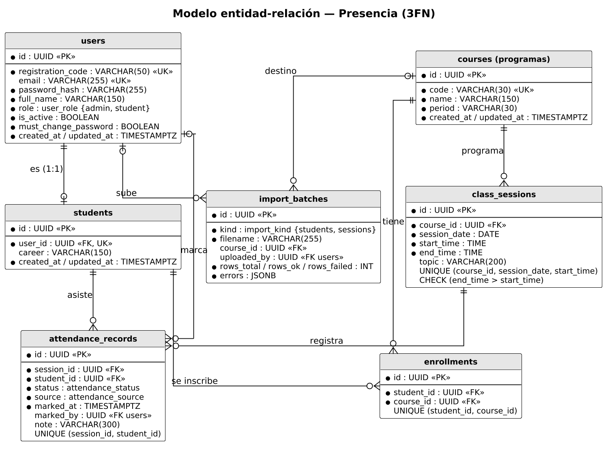
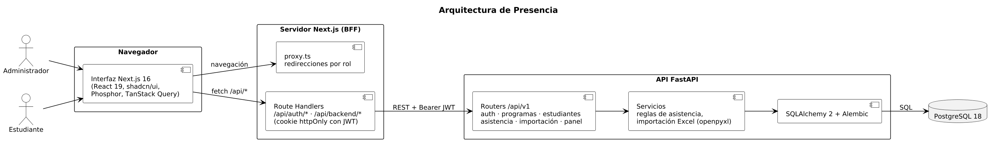
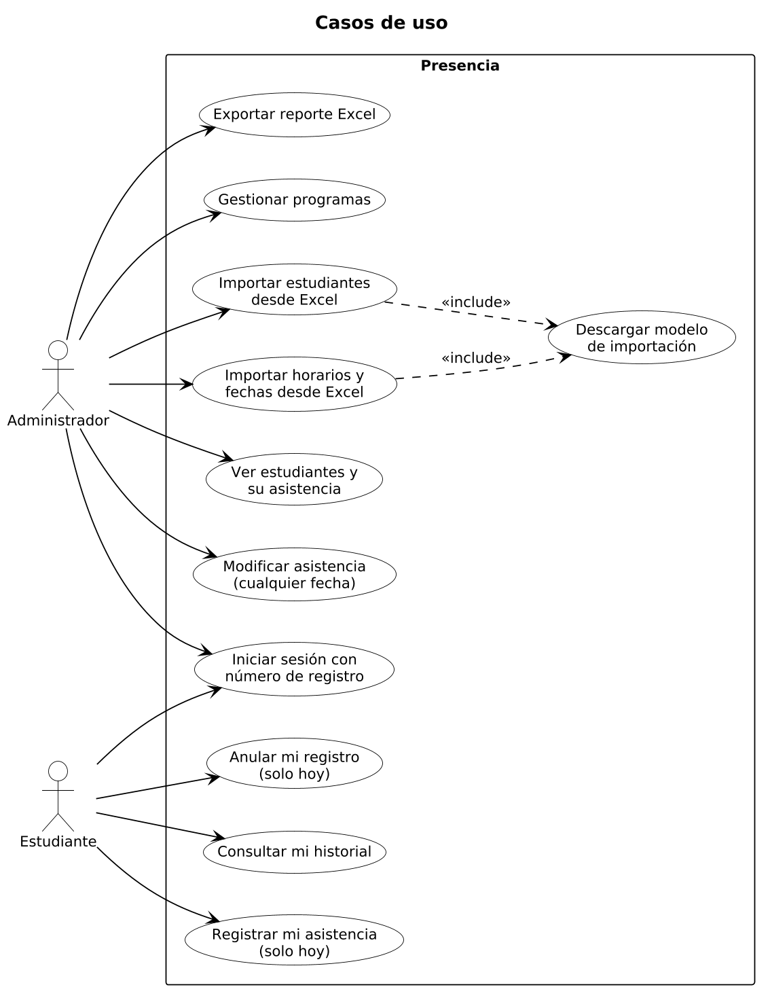
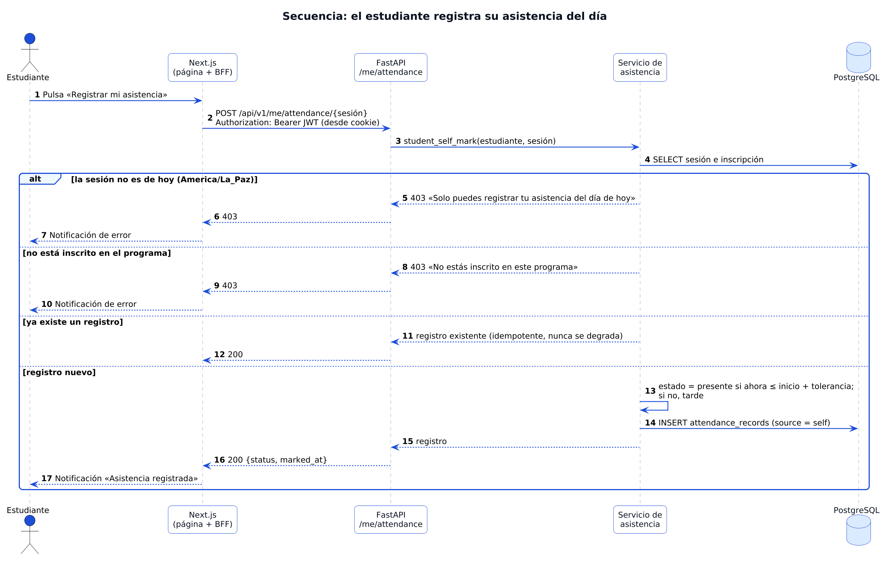

# Presencia · Sistema de registro de asistencia

Aplicación web para registrar y controlar la asistencia de estudiantes en uno o varios
programas académicos. Desarrollada por el **grupo GPT-6 AURA**.

- **Documentación técnica (PDF):** [`docs/Documentacion-Presencia.pdf`](docs/Documentacion-Presencia.pdf)

## Funcionalidades

- Dos tipos de usuario: **administrador** y **estudiante**. Todos ingresan con su número de
  registro.
- Importación de **estudiantes** y de **horarios y fechas** desde Excel, con modelo
  descargable y validación fila por fila.
- El administrador ve a todos los estudiantes, cada uno con su propia ficha, y **modifica la
  asistencia** de las sesiones dictadas y del día, con notas. Las sesiones futuras son de solo
  lectura.
- Cada estudiante **registra su asistencia del día** con un toque; solo puede registrar o
  anular la asistencia del día actual (zona horaria America/La_Paz, calculada en el servidor).
- Varios **programas** con sus propios estudiantes, horarios e indicadores.
- Panel con indicadores, gráfico por sesión, estudiantes en riesgo y exportación a Excel.

## Stack

| Capa | Tecnología |
|---|---|
| Frontend | Next.js 16 (App Router, Cache Components), React 19, TypeScript, Tailwind CSS 4, shadcn/ui, Phosphor Icons, TanStack Query |
| Backend | FastAPI, Pydantic 2, SQLAlchemy 2, Alembic, PyJWT, Argon2, openpyxl · Python 3.14 |
| Base de datos | PostgreSQL 18 |
| Infraestructura | AWS EC2, cloud-init, CloudFormation (anidado + Git Sync), Terraform, Pulumi, GitHub Actions |

## Diagramas (PlantUML)

Fuentes en [`docs/diagrams`](docs/diagrams); imágenes en `docs/diagrams/png`.

| | |
|---|---|
|  |  |
|  |  |

Para regenerarlos:

```bash
docker run --rm -v "$PWD/docs/diagrams:/data" -w /data plantuml/plantuml \
  -tpng -Sdpi=170 -charset UTF-8 -o png er.puml arquitectura.puml casos-uso.puml \
  secuencia-registro.puml secuencia-importacion.puml
```

## Ejecutar

### Con Docker

```bash
docker compose up --build
```

- Frontend: http://localhost:3001
- API: http://localhost:8000/docs

### Desarrollo local

```bash
docker compose up -d db

cd backend
uv sync
uv run alembic upgrade head
uv run python -m app.seed --demo
uv run uvicorn app.main:app --reload

cd ../frontend
pnpm install
pnpm dev --port 3001
```

### Acceso de demostración

| Rol | Registro | Contraseña |
|---|---|---|
| Administrador | `218166141` | `admin1234!` |
| Estudiante (en dos programas) | `219034521` | `admin1234!` |

Todas las cuentas nuevas usan la contraseña común `admin1234!` (variable `DEFAULT_PASSWORD`).

## Calidad

```bash
cd backend && uv run ruff check . && uv run pytest     # 26 pruebas
cd frontend && pnpm lint && pnpm build
```

## Estructura

```text
backend/    API FastAPI: modelos, servicios (reglas de negocio), routers, migraciones, pruebas
frontend/   Next.js: pantallas, BFF (/api/auth, /api/backend), componentes y proxy por rol
infraestructure/
  cloud-init/       Configuración de los dos servidores, compartida por las tres herramientas
  cloudformation/   Stacks anidados (red, seguridad, servidor) y deployment file de Git Sync
  environments/     Terraform: ambiente dev; modules/ tiene red, seguridad y EC2
  pulumi/           La misma infraestructura con Pulumi (Python)
docs/       Documentación PDF, diagramas PlantUML, capturas y archivos Excel de ejemplo
.github/    Escaneos de seguridad de las plantillas CloudFormation
```

## Despliegue

La app corre en AWS en dos EC2: el frontend (Nginx + Next.js, con IP elástica) y el backend
(FastAPI + PostgreSQL, accesible solo desde el frontend por su IP privada). Cada servidor se
configura solo en su primer arranque con cloud-init.

- **CloudFormation**: un push que cambia `infraestructure/cloudformation/anidados/deployment-file.yaml`
  o `main.yaml` lo despliega Git Sync. Ver [`infraestructure/cloudformation/README.md`](infraestructure/cloudformation/README.md).
- **Terraform y Pulumi**: se ejecutan a mano. Ver [`infraestructure/cloud-init/README.md`](infraestructure/cloud-init/README.md).
