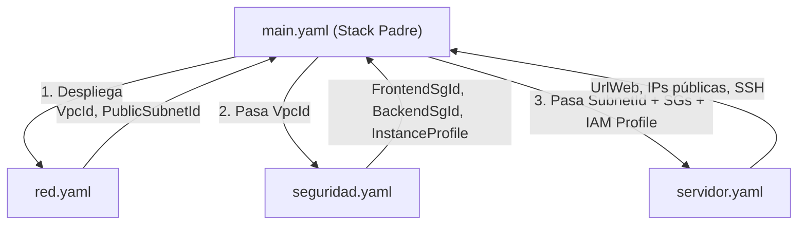

# Presencia · Infraestructura con CloudFormation (Stacks Anidados)

La misma infraestructura de `infraestructure/` (Terraform), implementada con la IaC nativa de AWS utilizando **Stacks Anidados (Nested Stacks)**:
**2 EC2 Ubuntu 24.04**, una para el **frontend** (Next.js + Nginx) y otra para el **backend**
(FastAPI + PostgreSQL), con VPC dedicada, Flow Logs con KMS, y **security groups** de mínimo privilegio.

---

## 📁 Estructura del Proyecto

Todos los templates anidados conviven en la misma carpeta (`anidados/`), lo que permite que el stack principal (`main.yaml`) referencie a los hijos directamente por nombre de archivo relativo:

```
cloudformation/
├── anidados/
│   ├── main.yaml          → Stack Padre (Orquestador principal)
│   ├── red.yaml           → Stack Hijo 1: VPC, IGW, subred pública, rutas, Flow Logs + KMS
│   ├── seguridad.yaml     → Stack Hijo 2: SG frontend, SG backend, rol IAM SSM
│   ├── servidor.yaml      → Stack Hijo 3: Key pair, Launch template, 2 EC2, EIP, UserData
│   └── deployment-file.yaml → Configuración para CloudFormation Git Sync
├── deploy.ps1 / deploy.sh    → Empaqueta (S3) y despliega todo ejecutando solo main.yaml
├── destroy.ps1 / destroy.sh  → Borra el stack principal y sus hijos en cascada
├── scan.sh                   → cfn-lint + 3 escáneres de seguridad (Docker)
└── reportes/                 → Auditorías de seguridad (Checkov, Trivy, cfn-nag)
```

---

## 🔗 Flujo de Datos entre Stacks Anidados

A diferencia de los stacks desacoplados con `Fn::ImportValue` (que crean bloqueos globales entre stacks), los **stacks anidados** pasan datos mediante **parámetros directos** usando `!GetAtt`:



| Stack Hijo | Entradas (Parámetros) | Salidas (Outputs) | Destino en `main.yaml` |
|---|---|---|---|
| `Red` (`red.yaml`) | `VpcCidr`, `PublicSubnetCidr` | `VpcId`, `PublicSubnetId` | Se pasan a `Seguridad` y `Servidor` |
| `Seguridad` (`seguridad.yaml`) | `VpcId`, `AdminCidr` | `FrontendSecurityGroupId`, `BackendSecurityGroupId`, `InstanceProfileName` | Se pasan a `Servidor` |
| `Servidor` (`servidor.yaml`) | `PublicSubnetId`, `FrontendSecurityGroupId`, `BackendSecurityGroupId`, `InstanceProfileName`, `RepoUrl` | `UrlAplicacion`, `FrontendPublicIp`, `BackendPublicIp`, comandos SSH | Salidas finales de `main.yaml` |

---

## 📦 Empaquetado y Despliegue ("Todo en un paquete")

CloudFormation exige que los templates anidados (`red.yaml`, `seguridad.yaml`, `servidor.yaml`) estén disponibles en un bucket de Amazon S3. 

El comando nativo de AWS para empaquetar y subir automáticamente todas las plantillas anidadas es:

```bash
# 1. Empaquetar (sube los templates locales a S3 y genera packaged.yaml con los TemplateURL finales)
aws cloudformation package \
  --template-file anidados/main.yaml \
  --s3-bucket <nombre-bucket> \
  --output-template-file anidados/packaged.yaml

# 2. Desplegar el main
aws cloudformation deploy \
  --template-file anidados/packaged.yaml \
  --stack-name asistencia-dev-main \
  --capabilities CAPABILITY_IAM CAPABILITY_AUTO_EXPAND \
  --parameter-overrides AdminCidr="TU.IP/32"
```

### Despliegue automatizado con 1 solo comando

Los scripts incluidos (`deploy.ps1` y `deploy.sh`) crean el bucket S3 automáticamente si no existe, empaquetan los templates y ejecutan el despliegue del stack `main`:

```powershell
# En Windows (PowerShell):
.\deploy.ps1 -AdminCidr "TU.IP/32"

# Modo Plan (Change Set sin aplicar cambios):
.\deploy.ps1 -AdminCidr "TU.IP/32" -Plan
```

```bash
# En Linux / macOS / Git Bash:
ADMIN_CIDR=TU.IP/32 ./deploy.sh
```

---

## 🔄 Sincronización con Git (CloudFormation Git Sync)

El proyecto incluye el archivo `anidados/deployment-file.yaml` compatible con la función **Sync from Git** de la consola de CloudFormation:

1. Ve a la consola de **AWS CloudFormation** → **Stacks** → **Create stack** → **With new resources (standard)**.
2. Selecciona **Sync from Git**.
3. Conecta tu repositorio de GitHub: `https://github.com/JuanaBP/presencia-aws.git` en la rama `main`.
4. Selecciona el archivo de despliegue: `infraestructure/cloudformation/anidados/deployment-file.yaml`.
5. CloudFormation sincronizará y actualizará el stack automáticamente con cada commit en Git.

> [!NOTE]
> Al desplegar stacks anidados mediante Git Sync directo desde la consola, AWS requiere que los templates referenciados estén accesibles o sincronizados. Para un flujo GitOps 100% automático, también se incluye el workflow de CI en `.github/workflows/cfn-security.yml`.

---

## 🗑️ Eliminación de Recursos

Con stacks anidados, no necesitas borrar cada recurso o stack hijo por separado. Al eliminar el stack principal `main`, CloudFormation elimina automáticamente todos los stacks hijos en orden inverso (`Servidor` → `Seguridad` → `Red`):

```powershell
# En Windows:
.\destroy.ps1
```

```bash
# En Linux / macOS:
./destroy.sh
```

---

## 🛡️ Escaneos de Seguridad

Las plantillas anidadas cumplen con las normativas de seguridad de infraestructura:
- IMDSv2 obligatorio.
- Cifrado en reposo gp3 con KMS.
- VPC Flow Logs activos con retención y clave dedicada.
- Security Groups de mínimo privilegio (puerto 8000 de FastAPI solo accesible desde el frontend).

Para ejecutar los escáneres locales:
```bash
./scan.sh
```
O mediante el pipeline de GitHub Actions en `.github/workflows/cfn-security.yml`.
